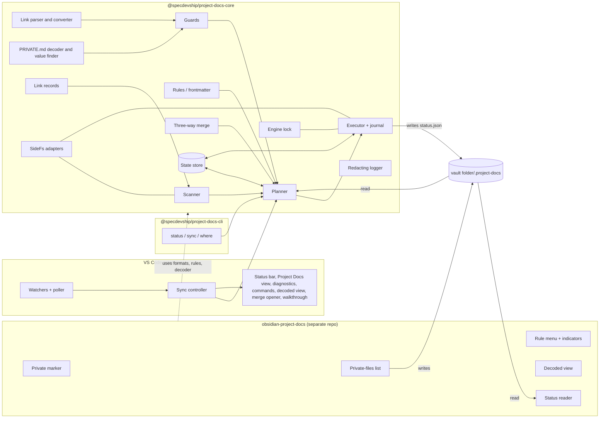
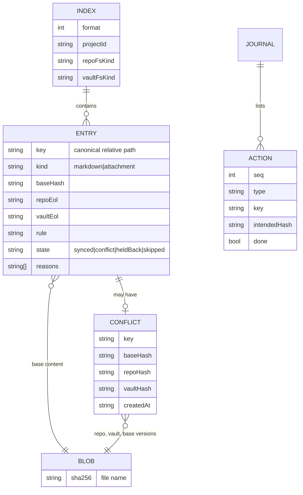

# Project Docs Design

## Summary

The core of the design is a **pure planner**. Each sync pass:

1. scans both sides into snapshots;
2. compares them with the stored bases;
3. produces an ordered list of **actions** (copy, merge, rename, trash, conflict, hold back, report).

A crash-safe **executor** then applies the actions through a journal, and **guards** filter every vault-to-repo action before it is planned. Everything with a data-loss or privacy consequence lives in this UI-free core: the planner, the merge, the guards, the PRIVATE.md decoder and the link formats. The core is shared byte for byte by:

- **the VS Code extension**, which adds watching, scheduling, the lock heartbeat and all UI;
- **the CLI**, which runs one pass and exits;
- **the Obsidian plugin**, which uses the core's formats, rules and decoder, but never runs passes.

The engine's working state lives in a per-user application-data folder. The plugin needs two pieces of state too, the engine's status and the private-files list, so those live in a hidden `.project-docs/` folder inside the vault folder that sync never touches.

## Architecture



### Core modules (`packages/core/src/`)

| Module | Responsibility |
|---|---|
| `paths/` | Canonical path keys (NFC, `/` separators, relative to the linked folder); case-folded keys for clash detection; portability checks (Windows reserved names and characters, trailing dot or space); WSL path translation. |
| `sidefs/` | The `SideFs` interface, plus a Node implementation with atomic writes (temporary file in the same folder, `fsync`, rename). Trash is injected (VS Code API, the `trash` package, or a vault `.trash` mover). |
| `scan/` | Walks one side into a `Snapshot`. It never follows symlinks or junctions, and skips (and reports) non-UTF-8 Markdown, files over 5 MB, and anything inside `.project-docs/`. Hashing is SHA-256 over line-ending-normalized content for Markdown, and over raw bytes otherwise. A stat cache skips re-hashing files whose size and modification time are unchanged. |
| `rules/` | Reads the `project-docs` property, and writes it by editing only the frontmatter block through `yaml`'s Document API. |
| `links/` | Parses Markdown with mdast to find code and frontmatter ranges and Markdown links. Tokenizes wikilinks and embeds outside those ranges. Resolves targets against a snapshot, converts eligible wikilinks into positional edits, and lists every link target for the guards. |
| `privatemd/` | The decoder ported from the standard's reference implementation, and a real-value finder (case-insensitive, values of 4+ characters, findings name the placeholder only). |
| `guards/` | Pure checks on a proposed vault-to-repo change: private subfolder, private marker, private-files list, the link note, the never-synced names (`PRIVATE.md`, `PRIVATE.example.md`, `*.private.md`), links to private or out-of-folder targets, and real values. |
| `merge/` | Wraps `node-diff3` on line-ending-normalized text. Returns either a clean merge or conflict hunks. |
| `plan/` | The pure function `plan(input) → Plan`. See "The planner" below. |
| `exec/` | Applies a `Plan` through the journal, updates the index after each action, and writes `status.json`. |
| `state/` | The state store: index, content-addressed blobs, conflicts, journal, pending bulk pass, log. |
| `lock/` | The engine lock: exclusive create, heartbeat, stale detection. |
| `records/` | Reads and writes the committed and machine-local link files and the link note's properties, and validates them. |
| `log/` | A logger that passes every message through the redactor (real values become placeholders) before it is written. |

### Extension (`packages/vscode/src/`)

| Component | Responsibility |
|---|---|
| `LinkService` | The link and unlink commands and their prompts. Reads Obsidian's vault registry (`obsidian.json` in Obsidian's config folder, resolved per platform and under WSL through `/mnt/<drive>`). Writes the link records. |
| `WatcherService` | VS Code `FileSystemWatcher`s on both folders, or the core's poller (every 5 seconds) for vault paths under `/mnt/` or on network drives. Turns events into a set of dirty paths. |
| `SyncController` | Holds the engine lock and its heartbeat. Debounces dirty paths by 300 ms, runs passes, runs the periodic rescan (every 10 minutes), manages the bulk-guard prompt, and handles pause and resume. |
| `StatusBar` | Shows sync health and, for the active Markdown file, its sync rule and coded or decoded mode. |
| `ProblemsView` | The Project Docs tree view, built from `status.json`: conflicts, held-back changes, skipped files and invalid rules, each with a resolve action. |
| `Diagnostics` | Problems-panel diagnostics on repo docs that contain real values or link to private notes (REQ-13.0.5). |
| `RuleMenu` | The Explorer context-menu items and the status-bar picker for sync rules. |
| `DecodedView` | A read-only virtual document scheme, `project-docs-decoded:`, with an editor-title toggle and a decoded Markdown preview. |
| `MergeOpener` | Opens `_open.mergeEditor`, falling back to a conflict-marker file. |
| `PrivateMdSetup` | The "Set up PRIVATE.md" command, the hook offer (it runs the standard's bundled `private_md.py install-hooks`), and the walkthrough. |

### CLI (`packages/cli/src/`)

There are three commands over the core. `sync` takes the lock (owner `cli`), scans, plans, applies the bulk guard (`--yes` to proceed), executes and releases. The repo side's trash uses the `trash` package.

### Obsidian plugin (separate repo; designed here, specified there)

| Component | Responsibility |
|---|---|
| `PrivateMarker` | Listens to vault `create` and `rename` events, and on startup sweeps the private subfolder. Sets `project-docs: private` through the core's `rules` writer. |
| `PrivateFilesList` | Where attachment sync is on: maintains `.project-docs/private-files.json`, tracking renames and modifications. |
| `RuleMenu` | File-menu items, a status-bar item and a note-header indicator. Asks for confirmation before un-privating a note. |
| `StatusReader` | Reads `.project-docs/status.json` for the status bar and for per-note notices. |
| `DecodedView` | Decoding in **reading view** first (decision 14), with a separate read-only view as the fallback. Either way: a fixed "Decoded: real values shown" header, and a toggle action on Markdown views. It reads PRIVATE.md from the repo path in the link note. |

## Key design decisions

### 1. Plan, then execute: a pure planner
**What:** each pass first computes a complete `Plan` from the snapshots, the index, the rules and the guards, without touching disk. Then it executes.
**Why:**
- The data-loss requirements (REQ-5.4, REQ-19.2) are only testable at scale if the decision logic is a pure function that fast-check can drive with random histories.
- The bulk guard (REQ-7) needs the whole pass's consequences before anything happens.
- The CLI's `status` (REQ-18) is just "plan, don't execute".

**Alternatives:** reacting to each watch event as it arrives. That's simpler for a single file, but makes bulk decisions and crash recovery much harder, and can't be tested without real watchers.

### 2. No path remapping: the same relative path on both sides
**What:** a file's key is its path relative to the linked folder, identical on both sides.
**Why:** the requirements dropped path remapping for the first release. With one key per file, renames, clashes and conflicts are all unambiguous.

### 3. Rename detection by content hash against the base
**What:** within one side, a path that disappeared and a path that appeared in the same pass, where the new file's hash equals the disappeared file's base hash, are a rename. A modified-and-moved file (different hash) is treated as a delete plus an add.
**Why:**
- This meets REQ-6.1 ("git shows a rename") for the common case without heuristics.
- The delete half of a modify-and-move goes to the trash, so nothing is lost.

**Alternatives:** similarity-based rename detection, like git's. It catches more cases, but a wrong match would merge unrelated files. It can be added later.

### 4. Line endings are normalized for comparison, preserved for writing
**What:**
- Markdown is hashed, merged and stored as bases with LF line endings.
- Each side's index entry remembers that side's line-ending style.
- A write converts to the target side's recorded style, or the side's default for new files: CRLF where the side's filesystem is Windows, LF otherwise.

**Why:** REQ-3.0.5 and 3.2. A Windows checkout with `core.autocrlf` must not look modified on every pass.

### 5. Guards run at plan time, and a held-back file freezes in both directions
**What:**
- Every vault-to-repo content change passes through `guards.check()`. A violation turns the action into `holdBack`: no write in either direction, and the reasons are recorded.
- While a file is held back, repo-side changes to it are not written to the vault either. The planner reports "held back, and the repo has also changed" until the vault-side cause is removed, then merges normally.

**Why:**
- REQ-13 requires that the repo never receives the offending content.
- Writing repo changes into the vault while the vault holds an unsynced edit would overwrite that edit, breaking REQ-5.0.4.
- Freezing both directions mirrors the conflict state (REQ-5.0.5), so there is one mental model.

### 6. Wikilink conversion writes back to the vault in the same pass
**What:** when a vault change converts wikilinks, the planner emits a write of the converted text to both sides and records it as the new base. The vault-side write fires a watch event, but its hash already matches the base, so the next pass sees no change.
**Why:** REQ-12.0.1 requires identical text on both sides, and the base comparison makes the engine's own writes self-quieting. There's no echo suppression to get wrong.

### 7. Two state locations: per-user app data for the engine, `.project-docs/` in the vault folder for what the plugin shares
**What:**
- **Engine state** (index, blobs, conflicts, journal, lock, log) lives in `<appdata>/project-docs/projects/<projectId>/`.
- **`status.json` and `private-files.json`** live in `<vault folder>/.project-docs/`. The scanner always excludes that folder, and Obsidian hides dot-folders.

**Why:**
- The CLI and the extension must share engine state (REQ-18, tech.md).
- The plugin must read status and own the private-files list, but under WSL the engine's app-data folder is inside WSL, which the Windows plugin can't find reliably. The vault folder is the one place both can reach.

**Alternatives:** have the plugin read the engine's app-data folder through the link note. That's fragile under WSL and couples the plugin to engine internals.

### 8. The engine runs where the repo is; the plugin never syncs
**What:** passes run only in the extension and the CLI (REQ-4.0.4). The plugin writes only frontmatter markers, the private-files list and notices.
**Why:** one engine per link (REQ-19.0.1), without cross-process coordination with Obsidian. The plugin's writes are ordinary vault edits that the engine sees and handles.

### 9. Turning a synced note private leaves the repo copy, and says so
**What:** when a previously synced note gets `project-docs: private`, the planner stops syncing it and leaves the repo copy untouched. It reports "no longer synced; the repo copy is still in the repo", with a "Move repo copy to trash" action.
**Why:**
- The requirements say private notes never reach the repo, but not what happens to a copy already there. Deleting a tracked repo file automatically would be a surprising destructive action.
- A visible prompt lets the user decide.

Confirmed with the user: offer to trash, don't trash automatically.

### 10. First sync, and recovery from lost state, use the same path
**What:** a pass with no index entry for a path treats it as a first sync:
- **only one side has the file:** copy it to the other side;
- **both sides have it with the same content:** record it as the base;
- **both sides have it with different content:** write the repo's version to the vault, and keep the vault's version as a conflict.

Missing or corrupt state empties the index, so the next pass behaves exactly like this.
**Why:**
- REQ-1.0.3 and REQ-19.0.4 ask for the same behaviour.
- With no index, a file that exists on only one side is always copied, never deleted, so lost state can resurrect a deleted file but never lose one (REQ-19.3).

### 11. The journal makes every action idempotent
**What:**
1. Before executing, the plan is written to `journal.json`.
2. Each action is skipped if its target already has the intended hash.
3. Each action is marked done after it succeeds and the index has been updated.

On startup, an existing journal is replayed before any new pass.
**Why:** REQ-19.0.3. Atomic writes plus "skip if already in the intended state" makes replay safe at any interruption point.

### 12. The bulk guard counts only destructive actions
**What:** the guard counts trashes plus overwrites of existing files whose content differs. Copies of new files and clean merges don't count. The threshold is `min(20, ceil(0.25 × linked files))`. A guarded plan is saved as `pending-bulk.json` and offered again until it's proceeded with or cancelled.
**Why:** REQ-7 targets branch switches and mistakes, not a first link that copies many new files.

### 13. The merge editor first, with a fallback for when VS Code changes
**What:**
- `MergeOpener` calls `_open.mergeEditor` with `base`, `input1` (repo) and `input2` (vault) as `project-docs-conflict:` virtual documents, and with `output` as a working file in the conflict store.
- A "Complete merge" action (the `projectDocs.resolveConflict` command, shown in the editor title for that output file) writes the result to both sides.
- If the command throws or isn't registered, the opener writes a working copy with `<<<<<<<` / `=======` / `>>>>>>>` markers instead. VS Code's built-in conflict decorations handle it, and the same resolve command refuses to complete while markers remain.

**Why:** tech.md's decision. A smoke test in the extension's integration suite fails if the internal command stops opening.

### 14. The decoded view is a virtual document, never a file
**What:**
- **VS Code:** `project-docs-decoded:/<path>` documents served by a `TextDocumentContentProvider`. These are read-only by construction. The provider refreshes when the source or PRIVATE.md changes, and the tab title ends with "(Decoded: real values shown)".
- **Obsidian, reading view first.** While decoded mode is on for a note, a Markdown post-processor uses `ctx.getSectionInfo(el)` to take each rendered section's *source* lines. It decodes them with the core, then re-renders that section from the decoded source with `MarkdownRenderer`. This decodes the source; it doesn't patch rendered text, so text split across elements is decoded correctly.
  - **Completeness check:** after rendering, the plugin runs the decoder's own placeholder pattern (with the standard's boundary rule) over the view's rendered text, and requires that no mapped placeholder remains. Text such as `notmyhost`, which the boundary rule never decodes, doesn't count. It also checks that every section had source info. Embeds and some plugin-rendered blocks don't.
  - **If either check fails:** the plugin clears the decoded rendering and opens the fallback view in its place, with a notice saying why. It never leaves a partly decoded page on screen.
- **Obsidian, fallback.** A separate read-only view that renders the whole decoded source with `MarkdownRenderer`.
- **A prototype gates the choice.** The plugin's first task is a prototype of the reading-view approach against notes with callouts, embeds, tables, footnotes and code. If the completeness check fails on ordinary notes, the fallback view becomes the default, and REQ-14.0.2's "in reading view" wording is revisited with you then.

Neither app can save a decoded document anywhere. Reading-view decoding changes only the rendered view, never the note's text.
**Why:** REQ-14.0.2, 14.0.3 and 14.2. A read-only virtual document or rendered view can't be typed into or saved, and never touches disk. Decoding section sources keeps the standard's whole-text rules, and the completeness check enforces fail-closed (REQ-14.0.5).

### 15. The link note is the folder note, and is never synced
**What:**
- The link note's path is computed from a configurable pattern, default `{folder}/{folderName}.md`.
- If the note exists, the link properties (`project-docs-id`, `project-docs-repo`, optionally `uid`) are merged into its frontmatter by the `rules` writer.
- The scanner tags it by path, so the guards always exclude it.

**Why:** REQ-2.0.2, 2.0.3 and 2.0.8 to 2.0.11.

### 16. Commit hooks reuse the standard's reference implementation
**What:** the extension bundles the standard's three scripts (MIT, attributed) and offers to run `python private_md.py install-hooks <repo>`. If Python isn't found, it explains that the hooks need Python, and doesn't install anything.
**Why:**
- REQ-15.0.4 asks for the standard's hooks.
- Reimplementing them in TypeScript would create a second checker to keep in sync with the standard.
- The installed hooks need Python at commit time anyway.

## Data model

### Committed link file: `<repo>/.project-docs.json`

```json
{
  "format": 1,
  "description": "Project Docs link: this repo's docs folder is kept in sync with a folder in an Obsidian vault. The vault's location on this machine is in .project-docs.local.json.",
  "projectId": "pd_3f2c9a1e-7b4d-4c1a-9e2f-5a6b7c8d9e0f",
  "docsFolder": "docs",
  "vaultFolder": "Projects/my-repo",
  "settings": {
    "privateSubfolder": "private",
    "folderNotePattern": "{folder}/{folderName}.md",
    "syncAttachments": false,
    "keepLinksAsWritten": false,
    "allowLinksOutsideProjectFolder": false,
    "advancedUriDeepLinks": false
  },
  "deepLink": "obsidian://adv-uri?uid=pd_3f2c9a1e-7b4d-4c1a-9e2f-5a6b7c8d9e0f"
}
```

`deepLink` is present only while `advancedUriDeepLinks` is on. The file is validated against a JSON schema shipped in the core, and `records/` rejects any absolute path in it.

### Machine-local link file: `<repo>/.project-docs.local.json` (gitignored)

```json
{
  "format": 1,
  "description": "Project Docs: this machine's location of the linked vault folder. Not committed.",
  "projectId": "pd_3f2c9a1e-7b4d-4c1a-9e2f-5a6b7c8d9e0f",
  "vaultRoot": "/mnt/c/Users/me/Vault",
  "vaultFolderPath": "/mnt/c/Users/me/Vault/Projects/my-repo",
  "linkNotePath": "/mnt/c/Users/me/Vault/Projects/my-repo/my-repo.md"
}
```

### Link note frontmatter: the vault folder's folder note

```yaml
project-docs-id: pd_3f2c9a1e-7b4d-4c1a-9e2f-5a6b7c8d9e0f
project-docs-repo: '\\wsl.localhost\Ubuntu\home\me\src\my-repo'
uid: pd_3f2c9a1e-7b4d-4c1a-9e2f-5a6b7c8d9e0f   # only with Advanced URI deep links on
```

The body gets an "Open repo in VS Code" link (`vscode://file/<path>`, or `vscode://vscode-remote/wsl+<distro>/<path>` for a WSL repo). It's added once, and the user's other content is left alone.

### Vault metadata: `<vault folder>/.project-docs/`

| File | Writer | Contents |
|---|---|---|
| `status.json` | engine | `{ format, updatedAt, state: "idle"\|"syncing"\|"paused"\|"attention", items: [{ kind, path, reasons[], placeholder? }] }`. Never contains real values. |
| `private-files.json` | plugin | `{ format, files: [{ path, sha256 }] }` |

### Engine state: `<appdata>/project-docs/projects/<projectId>/`



Other files in the folder:
- `lock.json`: `{ pid, host, owner: "vscode"|"cli", window?, heartbeatAt }`;
- `pending-bulk.json`: a saved guarded plan;
- `log/`: redacted rotating logs.

Unreferenced blobs are garbage-collected after each successful pass.

## Interfaces

### Core (public API of `@specdevship/project-docs-core`)

```ts
/** Which half of a link a path or operation belongs to. */
type Side = "repo" | "vault";

/** Filesystem access for one side, so the core never calls fs directly and tests can inject faults. */
interface SideFs {
  readonly side: Side;
  readonly root: string;
  readonly isWindowsFs: boolean;
  readonly caseInsensitive: boolean;
  list(): AsyncIterable<FileEntry>;
  read(key: string): Promise<Uint8Array>;
  writeAtomic(key: string, data: Uint8Array): Promise<void>;
  rename(from: string, to: string): Promise<void>;
  trash(key: string): Promise<void>;
}

/** Scans one side into a snapshot of keys to hashes, skipping and reporting unsyncable files. */
function scan(fs: SideFs, opts: ScanOptions): Promise<Snapshot>;

/** Pure: decides everything a pass would do. No I/O. */
function plan(input: {
  repo: Snapshot; vault: Snapshot; index: Index;
  settings: LinkSettings; privateFiles: PrivateFilesList;
  privateMd: PrivateMdMapping | null; readContent: (side: Side, key: string) => string;
}): Plan;

/** Applies a plan through the journal; resumable. */
function execute(plan: Plan, ctx: ExecContext): Promise<PassResult>;

/** Engine lock across VS Code windows and CLI runs. */
function acquireLock(stateDir: string, owner: LockOwner): Promise<LockHandle | LockHeldBy>;

/** Link records. */
function readLink(repoRoot: string): Promise<LinkRecords | LinkProblem>;
function writeLink(records: LinkRecords): Promise<void>;

/** Frontmatter sync rule. */
type SyncRule = "sync" | "repo-to-vault" | "repo-only" | "private";
function readRule(markdown: string): SyncRule | InvalidRule;
function setRule(markdown: string, rule: SyncRule): string; // only the property changes

/** PRIVATE.md (conforms to the standard). */
function loadPlaceholders(privateMd: string): PrivateMdMapping;  // throws PrivateMdError
function restore(text: string, mapping: PrivateMdMapping): string;
function findRealValues(text: string, mapping: PrivateMdMapping): Finding[]; // placeholders only

/** Links. */
function convertWikilinks(markdown: string, resolve: LinkResolver): { text: string; unconvertible: LinkRef[] };
function linkTargets(markdown: string, resolve: LinkResolver): LinkTarget[];
```

`Plan` is a list of tagged actions:

| Action | Meaning |
|---|---|
| `copy {from, key, hash}` | Copy the file from one side to the other. |
| `writeBoth {key, text, hash}` | Write the same text to both sides (merge results and wikilink conversions). |
| `rename {side, from, to}` | Rename on the given side. |
| `trash {side, key}` | Move to that side's trash. |
| `conflict {key, repoHash, vaultHash, baseHash}` | Record an unresolved conflict. |
| `holdBack {key, reasons}` | Keep a vault change out of the repo. |
| `skip {key, reason}` | Don't sync the file, and report why. |
| `adopt {key, hash}` | Record agreement on both sides as the new base, with no write. |

`Plan` also carries `bulk: {destructive, threshold, guarded}`.

### Planner decision table (Markdown files, per key, after rename detection)

| Repo vs base | Vault vs base | Action |
|---|---|---|
| unchanged | unchanged | — |
| changed | unchanged | `copy` repo → vault (subject to the rule) |
| unchanged | changed | guards, then `copy` vault → repo, or `holdBack` |
| changed | changed, same content | `adopt` |
| changed | changed, different | guards on the vault side, then merge: clean → `writeBoth`; overlap → `conflict` |
| deleted | unchanged | `trash` vault |
| unchanged | deleted | `trash` repo |
| deleted | changed | `copy` vault → repo, plus the notice "delete overridden" (REQ-6.0.4) |
| changed | deleted | `copy` repo → vault, plus the same notice |
| no base | — | first-sync rules (decision 10) |

Rules modify the table:
- `repo-only`: never written to the vault. An existing vault copy gets `trash` behind a confirmation.
- `repo-to-vault`: a vault change becomes a report. The next repo change turns it into a `conflict` rather than an overwrite.
- `private`, or inside the private subfolder: never written to the repo.
- Never-synced names and the link note: `skip` silently.

### Extension contributions

- **Commands:**
  - `projectDocs.link`, `projectDocs.unlink`, `projectDocs.syncNow`, `projectDocs.pause`, `projectDocs.resume`;
  - `projectDocs.proceedBulk`, `projectDocs.cancelBulk`;
  - `projectDocs.setRule`;
  - `projectDocs.toggleDecoded`, `projectDocs.openDecodedPreview`;
  - `projectDocs.resolveConflict`, `projectDocs.openInObsidian`, `projectDocs.setupPrivateMd`, `projectDocs.installHooks`, `projectDocs.showLog`.
- **Menus:**
  - `explorer/context`: a set-rule submenu for `.md` files in the docs folder;
  - `editor/title`: a decoded/coded toggle, shown when the repo has a valid PRIVATE.md;
  - the merge output's title: Complete merge.
- **Views:** a `projectDocs.problems` tree in the Explorer container.
- **Walkthroughs:** `projectDocs.gettingStarted`, with steps for linking, sync rules and PRIVATE.md.
- **Activation:** `workspaceContains:.project-docs.json`, plus the link command.
- **Entry points:**
  - `main`: the Node entry point, which does all the work;
  - `browser`: a tiny web stub whose only job is to show "Project Docs needs desktop VS Code" in browser-based VS Code (REQ-21.0.3).
- **`extensionKind: ["workspace"]`**, so the extension runs inside WSL when the repo is there.

### CLI

```
project-docs status [--json]      # plan only; prints actions and problems
project-docs sync [--yes] [--json] # one pass; exits 2 if the bulk guard stops it without --yes
project-docs where                # prints the vault folder path; exits 1 if not linked
```

Exit codes:
- 0: success;
- 1: not linked, or an error;
- 2: the bulk guard is waiting;
- 3: the lock is held by another engine. The message names the holder: "VS Code (window …)" or "another project-docs run".

## Error handling & edge cases

| Situation | Handling | Requirement |
|---|---|---|
| Vault folder inside the repo, or repo folder inside the vault | `LinkService` compares real paths, including symlink resolution and case, and refuses. | 1.0.4, 1.4 |
| Machine-local link file missing | Re-link prompt that keeps `projectId`. The engine state for that id is reused if present. | 2.0.7, 2.5 |
| PRIVATE.md missing or invalid | The decoded toggle shows the standard's error. The guards' real-value check is skipped, with a one-time notice saying real-value protection is off until PRIVATE.md is restored. | 14.0.5, 14.4 |
| A write fails (locked file, permissions) | The action stays undone in the journal and is retried on the next pass. Repeated failure surfaces as an item in the Project Docs view. | 19.0.3 |
| Crash mid-pass | Journal replay on start (decision 11). | 19.0.3, 19.2 |
| Two windows on one repo | The second gets `LockHeldBy` and shows "Sync handled by another window". It takes over when the heartbeat goes stale. | 19.0.1, 19.1 |
| CLI while VS Code is syncing | Exit code 3, naming VS Code. | 18.0.2, 18.3 |
| Branch switch with many deletions | The bulk guard (decision 12). | 7.1, 7.2 |
| Case-only rename on a case-insensitive side | The scanner reports the real on-disk case. Rename detection compares exact keys after matching folded keys. The executor renames through a temporary name (`a.md` → `a.md.pd-tmp` → `A.md`). | 6.0.2, 6.2 |
| Two files that clash by case | Both get `skip` with a clash reason when either side is case-insensitive. | 16.0.3, 16.3 |
| A name that's illegal on the other side | `skip` with a reason, using portability checks against the target side's `isWindowsFs`. | 16.0.2, 16.2 |
| Non-UTF-8 Markdown, or a file over 5 MB | Skipped by the scanner, and reported. | 16.0.4, 16.4, 20.3 |
| Symlink or junction | Not followed; reported. | 16.0.5 |
| Invalid `project-docs` value | `skip` with the value in the reason. | 8.0.2, 8.4 |
| Un-privating a note | Plugin confirmation (`RuleMenu`). The engine sees an ordinary vault change afterwards. | 9.0.4, 9.3 |
| A private file arrives while Obsidian is closed | The engine excludes it by folder (10.0.1). The plugin marks it on start. | 10.0.4, 10.0.6, 10.3 |
| An attachment moved out of the private folder and edited elsewhere | Not covered by the private-files list. Recorded as an open question in product.md, and accepted for the first release. | — |
| Wikilink target missing or ambiguous | Left as written, and reported as unconvertible. | 12.0.2 |
| A held-back change whose cause is removed | Re-evaluated on the next pass, then synced. | 13.0.4 |
| A real value accepted for replacement | The extension or plugin rewrites the vault file, replacing each real value with its placeholder (longest first, with the standard's boundary rule), and the change then syncs. | 13.3 |
| Watcher events missed | Periodic rescan, and the poller where watching is unreliable. | 4.0.2, 4.0.3, 4.3 |
| The merge editor command is missing | Conflict-marker fallback (decision 13). | 5.0.3 |
| Browser-based VS Code | The web stub shows the "needs desktop VS Code" message. | 21.0.3 |

## Traceability

| Requirement | Design coverage |
|---|---|
| REQ-1 Link a project | `LinkService`; decision 10 (first sync); error table (nesting) |
| REQ-2 Link record and agent discovery | Data model (link files, link note); `records/`; decisions 15 and 16; `projectDocs.openInObsidian`; WSL translation in `paths/` |
| REQ-3 Two-way sync | `scan/`, `plan/`, `exec/`; `SideFs.writeAtomic`; decision 4; never-synced names in `guards/` |
| REQ-4 Detecting changes | `WatcherService`, the poller, the periodic rescan in `SyncController`; first-pass reconciliation on open |
| REQ-5 Merging and conflicts | `merge/`; decision table; decision 13; conflict store |
| REQ-6 Renames, moves, deletes | Decision 3; the case-rename procedure; trash adapters; decision table rows for delete vs change |
| REQ-7 Bulk-change guard | Decision 12; `pending-bulk.json`; CLI exit code 2 |
| REQ-8 Sync rules | `rules/`; rule modifiers on the decision table |
| REQ-9 Rule changes with the mouse | Extension `RuleMenu` and `StatusBar`; plugin `RuleMenu`; `setRule` |
| REQ-10 Private notes | `guards/` (folder and marker); plugin `PrivateMarker`; decision 9 |
| REQ-11 Non-Markdown files | `settings.syncAttachments`; whole-file copy and conflict; plugin `PrivateFilesList`; guards on the list |
| REQ-12 Links between docs | `links/`; decision 6; `keepLinksAsWritten` |
| REQ-13 Keeping private content out | `guards/`; decision 5; `Diagnostics`; real-value replacement |
| REQ-14 Decoded views | `privatemd/`; decision 14; extension `DecodedView`; plugin `DecodedView` |
| REQ-15 PRIVATE.md discoverability | `PrivateMdSetup`; walkthrough; decision 16; editor-title toggle |
| REQ-16 Platform parity | `paths/` portability and case handling; `SideFs.isWindowsFs` and `caseInsensitive`; scanner skips; CI matrix (tech.md) |
| REQ-17 Status and problems | `status.json`; `StatusBar`; `ProblemsView`; plugin `StatusReader`; `log/` redaction |
| REQ-18 CLI | `packages/cli`; lock owner; exit codes |
| REQ-19 Safe operation | `lock/`; decision 11; decision 10 for lost state; the state location |
| REQ-20 Performance | Stat-cache hashing; debounce; polling only where needed; scanner size cap |
| REQ-21 Quality and distribution | Pure planner for property tests (decision 1); merge-editor smoke test; web stub; CI matrix and coverage (tech.md) |

**Acceptance criteria to watch:**
- **2.3 (the agent test):** depends on the link files' `description` fields and the README's documentation, not just code. It needs a manual or scripted agent run, recorded in the walkthrough.
- **4.2 (WSL to `C:` within 10 seconds):** relies on the 5-second poller interval plus the pass time.

## Open questions

None at this time. Both earlier questions are resolved:

1. **Turning a synced note private:** the repo copy stays, with an offer to move it to the trash (decision 9).
2. **Obsidian's decoded view:** reading view first, with the separate view as a fallback, decided by a prototype (decision 14).

**One section-level risk carries forward.** Decoding section by section could split a placeholder across a section boundary. That can't actually happen: placeholders contain no line breaks, and sections break only at line boundaries. The prototype should confirm this.

## Visual design application

Not applicable. This is a Requirements-First spec with no `design-system.md` or `art-bible.md`. The UI uses VS Code's and Obsidian's native components.
